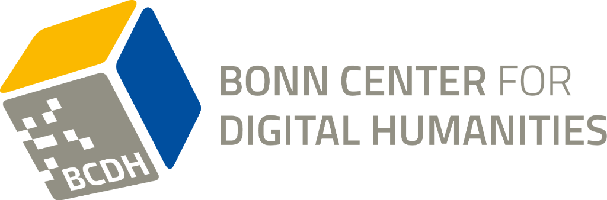

<p align="center">
  
</p>

<h1 align="center">HERMES — Heritage Metadata Entry System</h1>

<p align="center">
  <strong>Standards-compliant CARARE 2.0.6, 3D Metadata, Digital Authenticity Profile (DAP) &amp; BagIt Authoring for Cultural Heritage</strong>
</p>

<p align="center">
  
  
  
  
  
  <a href="LICENSE"></a>
</p>

<p align="center">
  <a href="https://github.com/mlangsqrldev/HERMES/wiki"><strong>Project Wiki</strong></a> ·
  <a href="https://github.com/mlangsqrldev/HERMES/wiki/Getting-Started">Getting Started</a> ·
  <a href="https://github.com/mlangsqrldev/HERMES/wiki/CARARE-Data-Model">CARARE 2.0.6 Model</a> ·
  <a href="https://github.com/mlangsqrldev/HERMES/wiki/3D-Metadata-and-DAP">3D &amp; DAP</a> ·
  <a href="https://github.com/mlangsqrldev/HERMES/wiki/Exports-and-BonnData">Exports &amp; BonnData</a> ·
  <a href="public/manual.html">Scholarly Manual (DE/EN)</a>
</p>

---

## Overview

**HERMES** (*Heritage Metadata Entry System*) is a bilingual (**German / English**) desktop and web application developed at the **Bonn Center for Digital Humanities (BCDH), University of Bonn**. It guides museums, archaeologists, and 3D digitization teams through creating, validating, linking, and archiving scholarly **CARARE 2.0.6** (CIDOC-CRM / Europeana 3D) metadata — without requiring XML expertise.

### Why HERMES?

| Pillar | What HERMES Provides |
| :--- | :--- |
| **4-Pillar CARARE 2.0.6 Authoring** | Dedicated forms for *Collection*, *Heritage Asset*, *Digital Resource* (3D Archival Masters & Web-GLB Derivatives), and *Activity*, producing XML conformant with the official **CARARE 2.0.6 XSD** (`http://www.carare.eu/carareSchema`). |
| **3D Acquisition & DAP** | Specialized metadata for **Photogrammetry (SfM)**, **Structured Light (SLS)**, and **Terrestrial Laser Scanning (TLS)**, drag-and-drop 3D file inspection, **IPTC AI transparency**, EPSG georeferencing, and the **5-dimension Digital Authenticity Profile (DAP)**. |
| **Central Relations & Hierarchy (Step 5)** | Structured Two-List assignment view for object hierarchies (`hasPart`/`isPartOf`), `isRepresentationOf`, `isDerivativeOf`, per-model Activity links (`hasCreated`), and 1-click **Auto-Match**. |
| **Authority Files & Reusable Pools** | Live lookups for **HECTOR SKOSMOS**, **GND (lobid)**, **ORCID**, **PeriodO**, **Pleiades**, **GeoNames**, **Leaflet**, and **EPSG (`spatialreference.org`)**, plus local Persons/Organizations/Software/Equipment pools with JSON backup & restore. |
| **Archival Exports & Reports** | Resizable **Live XML Split-Screen**, combined & split **CARARE 2.0.6 XML**, **BagIt (RFC 8493)** ZIP with native Rust SHA-256 streaming, scholarly **PDF / Markdown reports**, and **BonnData / Dataverse** API publishing. |
| **Zero-Install Portable Desktop App** | Single standalone 64-bit Windows executable in [`HERMES_Windows_Release_Package/`](HERMES_Windows_Release_Package/) with the interactive bilingual manual embedded inside. |

---

## Documentation & Wiki

Full user and developer documentation lives in the **[HERMES Wiki](https://github.com/mlangsqrldev/HERMES/wiki)**:

| Page | Summary |
| :--- | :--- |
| **[Home](https://github.com/mlangsqrldev/HERMES/wiki)** | Project overview, system architecture diagram, and release highlights |
| **[Getting Started](https://github.com/mlangsqrldev/HERMES/wiki/Getting-Started)** | Portable Windows startup, developer setup, global defaults, and 6-step workflow |
| **[CARARE 2.0.6 Data Model](https://github.com/mlangsqrldev/HERMES/wiki/CARARE-Data-Model)** | Four-pillar CIDOC-CRM structure, XSD conformance, role separation, and bibliographic references |
| **[Relations & Hierarchy](https://github.com/mlangsqrldev/HERMES/wiki/Relations-and-Hierarchy)** | Step 5 Two-List Relations UI, object hierarchies, Master/Derivative links, and Auto-Match |
| **[3D Metadata & DAP](https://github.com/mlangsqrldev/HERMES/wiki/3D-Metadata-and-DAP)** | SfM/SLS/TLS, 3D Inspector, Web-GLB derivatives, IPTC AI disclosure, and 5-dimension DAP |
| **[Authority Files & Pools](https://github.com/mlangsqrldev/HERMES/wiki/Authority-Files-and-Pools)** | Controlled vocabularies, GND deduplication, central pools, and JSON backup/restore |
| **[Exports & BonnData](https://github.com/mlangsqrldev/HERMES/wiki/Exports-and-BonnData)** | Live XML, combined/split CARARE XML, BagIt RFC 8493, PDF reports, and BonnData API |
| **[Building from Source (Linux / macOS / Windows)](https://github.com/mlangsqrldev/HERMES/wiki/Building-from-Source)** | Native desktop builds (`.deb`/`.rpm`/`.AppImage`, `.app`/`.dmg`, `.exe`/`.msi`) & Rust-free browser mode |
| **[Architecture & Developer Guide](https://github.com/mlangsqrldev/HERMES/wiki/Architecture-and-Developer-Guide)** | Tech stack, repository layout, Vitest suites, XSD validation, and release checklist |
| **[Changelog](https://github.com/mlangsqrldev/HERMES/wiki/Changelog)** | Consolidated release history (`v0.1.5` → `v0.1.36`) |

- **Interactive User Manual (DE / EN):** [`public/manual.html`](public/manual.html) (also standalone at [`HERMES_Windows_Release_Package/HERMES_Manual.html`](HERMES_Windows_Release_Package/HERMES_Manual.html))
- **Sample CARARE 2.0.6 Dataset:** [`samples/giza_pyramid_carare_2.0.6.xml`](samples/giza_pyramid_carare_2.0.6.xml)

---

## Quick Start

### End Users (Windows 10 / 11)
Download and double-click [`HERMES_Windows_Release_Package/HERMES_v0.1.36_2026-11-26.exe`](HERMES_Windows_Release_Package/HERMES_v0.1.36_2026-11-26.exe) — no installation required.

### Building on Linux, macOS & Windows

HERMES builds natively on **Linux** (`.deb`, `.rpm`, `.AppImage`), **macOS** (Apple Silicon & Intel `.app` / `.dmg`), and **Windows** (`.exe` / `.msi`), and also runs in any browser without Rust (`npm run dev`).

```bash
# 1. Install frontend dependencies
npm install

# 2. Run unit & CARARE roundtrip tests (Vitest)
npm test

# 3. Start browser mode (no Rust required — Linux / macOS / Windows)
npm run dev

# 4. Run or build the native Tauri 2 desktop app
npm run tauri dev
npm run tauri build
```

For platform-specific native prerequisites (`libwebkit2gtk-4.1-dev`, Xcode Command Line Tools, Visual Studio C++ Build Tools, Universal macOS builds, and troubleshooting), see the **[Building from Source](https://github.com/mlangsqrldev/HERMES/wiki/Building-from-Source)** wiki guide.

---

## Institutional Support & Funding

<p align="left">
  <a href="https://www.bcdh.uni-bonn.de/">
    
  </a>
</p>

**HERMES** is developed at the **[Bonn Center for Digital Humanities (BCDH)](https://www.bcdh.uni-bonn.de/)**, University of Bonn.

This project is funded by the **Deutsche Forschungsgemeinschaft (DFG, German Research Foundation)** within the **[NFDI4Objects](https://www.nfdi4objects.net/)** consortium (*National Research Data Infrastructure for the Material Remains of Human History*).

---

## License

Released under the **[MIT License](LICENSE)** — Copyright © 2026 Bonn Center for Digital Humanities (BCDH), University of Bonn.
