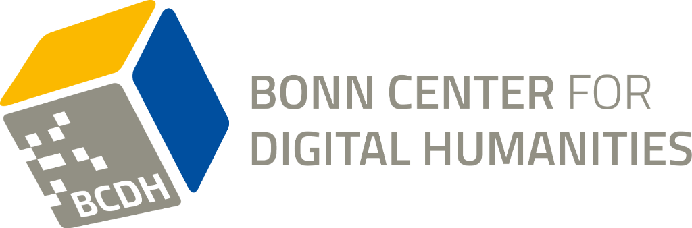
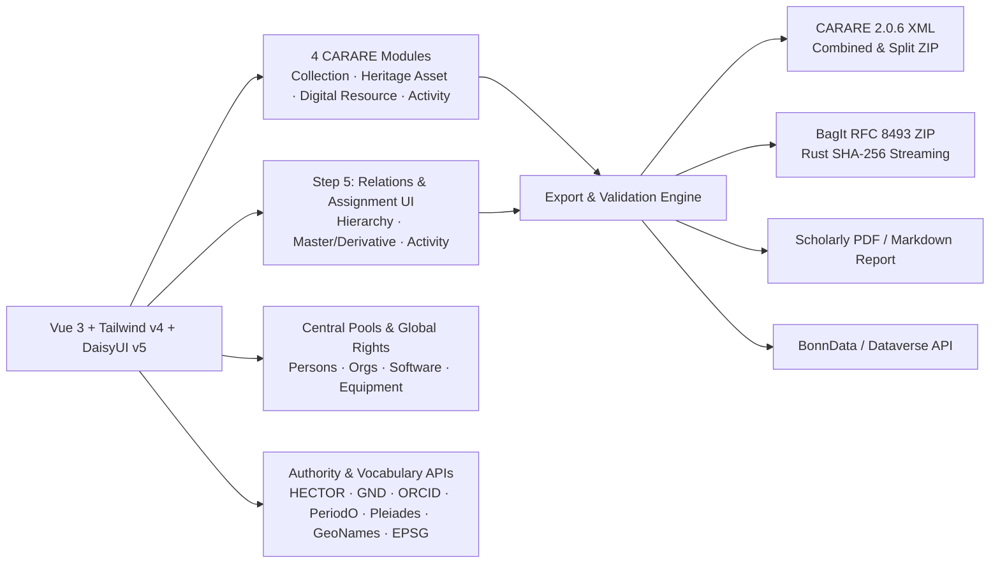

# HERMES — Heritage Metadata Entry System

  

Welcome to the **HERMES** project wiki!

**HERMES** (*Heritage Metadata Entry System*) is a bilingual (**German / English**) desktop and web application developed at the **[Bonn Center for Digital Humanities (BCDH)](https://www.bcdh.uni-bonn.de/), University of Bonn**, funded by the **Deutsche Forschungsgemeinschaft (DFG, German Research Foundation)** within the **[NFDI4Objects](https://www.nfdi4objects.net/)** consortium (*National Research Data Infrastructure for the Material Remains of Human History*).

It enables museums, archaeologists, and 3D digitization teams to create, validate, link, and archive standards-compliant **CARARE 2.0.6** (CIDOC-CRM / Europeana 3D) metadata, **Digital Authenticity Profiles (DAP)**, **BagIt (RFC 8493)** archival packages, scholarly **PDF reports**, and **BonnData / Dataverse** submissions.

---

## Architecture at a Glance

---

## Wiki Navigation

| Guide | What You Will Find |
| :--- | :--- |
| **[Getting Started](Getting-Started.md)** | Portable Windows `.exe` launch, dev installation, global header defaults, and the 6-step workflow |
| **[CARARE 2.0.6 Data Model](CARARE-Data-Model.md)** | The 4-pillar model, XSD conformance (`carare-v2.0.6.xsd`), mandatory fields, and bibliographic references |
| **[Relations & Hierarchy](Relations-and-Hierarchy.md)** | Step 5 Two-List Relations UI, object hierarchies, Master/Derivative links, per-model Activity assignment, and Auto-Match |
| **[3D Metadata & DAP](3D-Metadata-and-DAP.md)** | Photogrammetry/SfM, SLS, TLS, 3D Inspector, Web-GLB derivatives, IPTC AI transparency, and the 5-dimension DAP |
| **[Authority Files & Pools](Authority-Files-and-Pools.md)** | HECTOR SKOSMOS, GND, ORCID, PeriodO, Pleiades, GeoNames, EPSG, local pools, and JSON backup/restore |
| **[Exports & BonnData](Exports-and-BonnData.md)** | Live XML split-screen, combined/split CARARE XML, BagIt RFC 8493, PDF reports, BonnData API, and JSON templates |
| **[Architecture & Developer Guide](Architecture-and-Developer-Guide.md)** | Codebase layout, Tauri 2 / Rust backend, testing with Vitest, XSD validation, and release builds |
| **[Changelog](Changelog.md)** | Consolidated release history from `v0.1.5` to `v0.1.34` |

---

## Current Release (`v0.1.34`)

- **Portable Windows binary:** `HERMES_Windows_Release_Package/HERMES_v0.1.34_2026-11-25.exe`
- **Built-in bilingual manual:** `public/manual.html` (also standalone at `HERMES_Windows_Release_Package/HERMES_Handbuch_Manual.html`)
- **Sample dataset:** `samples/pyramide_gizeh_carare_2.0.6.xml` (1 Collection, 10 Heritage Assets in a 4-level hierarchy, 20 Digital Resources, 1 Activity)
- **Official XSD schema:** `CARARE/carare-v2.0.6.xsd`

---

## Funding & Institutional Support

Developed at the **[Bonn Center for Digital Humanities (BCDH)](https://www.bcdh.uni-bonn.de/)**, University of Bonn.
Funded by the **Deutsche Forschungsgemeinschaft (DFG, German Research Foundation)** as part of the **[NFDI4Objects](https://www.nfdi4objects.net/)** consortium (*National Research Data Infrastructure for the Material Remains of Human History*).
